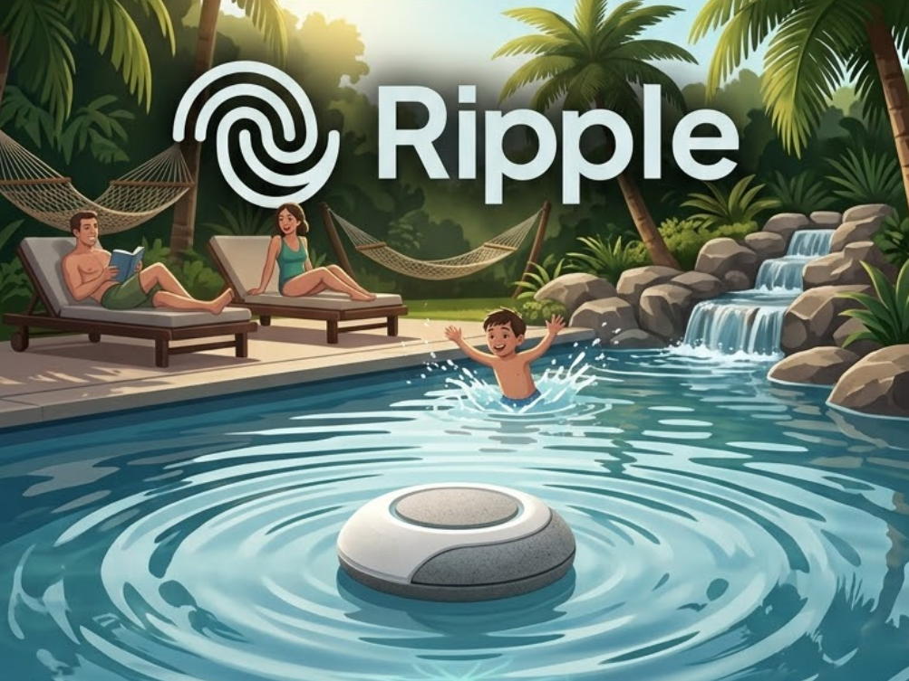

# Ripple — Aplicativo (Protótipo Visual)

<p align="center">
  
</p>

> **Interface conceitual em Progressive Web App (PWA) para o sistema de segurança de piscinas Ripple.**

> [!WARNING]
> **Status do Projeto: Protótipo / Mock Visual**  
> Este aplicativo é atualmente uma **prova de conceito de interface (PoC)** com dados e comportamentos simulados. **Ele ainda não possui conexão real (Bluetooth/Wi-Fi/Nuvem) com a boia física ou com o firmware.**

---

## Sobre o Protótipo

O **Ripple App** foi concebido para validar a experiência de uso (UX/UI) no monitoramento de piscinas contra quedas acidentais. Ele foi construído em tecnologia web pura (*vanilla*), sem necessidade de instalação de pacotes pesados ou etapas de compilação, e funciona como PWA instalável no celular.

### Telas e Funcionalidades Simuladas:
- **Início (`#inicio`):**
  - Indicador visual de estado (*Piscina segura* vs. *Queda detectada!*).
  - Nível de bateria e status da boia fictícios.
  - **Botão de simulação de alerta:** demonstra o fluxo de disparo de emergência com vibração tátil no celular (`navigator.vibrate`) e botões de resposta rápida (*"Estou indo"* / *"Alarme falso"*).
- **Visão Geral (`#visao-geral`):**
  - Painel de métricas de diagnóstico (qualidade do sinal, sensibilidade, contadores mensais de eventos e lista de responsáveis).
- **Histórico (`#historico`):**
  - Gráfico dinâmico de barras simulando frequência de eventos semanais e mensais com lista cronológica.

---

## Estrutura do Repositório

```text
ripple-app/
├── asset/                  # Imagens e ícones da aplicação (PWA / Touch Icons / Banner)
│   ├── apple-touch-icon.png
│   ├── icon-192.png
│   ├── icon-512.png
│   └── ripple-banner.png
├── index.html              # Interface, layout e regras do protótipo (SPA Vanilla)
├── manifest.webmanifest    # Manifesto PWA configurado com os caminhos da pasta asset/
└── README.md               # Documentação técnica do projeto
```

---

## Tecnologias

- **HTML5 + CSS3:** Layout responsivo simulando formato de smartphone em telas grandes e adaptável a telas móveis (com suporte a *safe area* de entalhes/notch).
- **JavaScript Vanilla:** Navegação SPA por *hash* e renderização dos dados simulados.
- **PWA (Progressive Web App):** Manifesto e ícones prontos para instalação na tela inicial (*Add to Home Screen*).

---

## Como Executar

Basta abrir o `index.html` no navegador ou usar um servidor estático simples:

```bash
# Com Python:
python -m http.server 8000

# Ou com Node.js:
npx serve .
```

Acesse: `http://localhost:8000` (ou `http://IP_DA_SUA_MAQUINA:8000` pelo celular na mesma rede Wi-Fi).

---

## Próximos Passos (Integração Real)

- [ ] Implementar comunicação direta com o [`ripple-firmware`](https://github.com/samuelocosta/ripple-firmware) via **Web Bluetooth API** ou broker MQTT.
- [ ] Substituir telemetria estática por dados reais do sensor inercial e divisor de bateria.
- [ ] Adicionar suporte a notificações push nativas em segundo plano.
